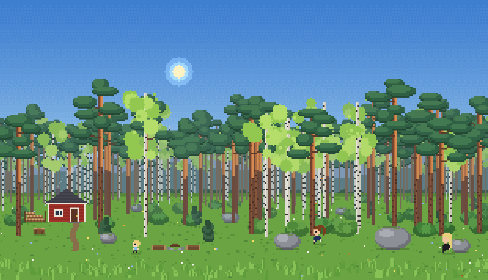

# Karjalan Metsämökki

Living pixel-art wallpaper for the Windows desktop: a Karelian mixed forest with a small red cabin where a family lives.
Time of day, seasons and weather follow the real clock and the real forecast. You build the family yourself:
people, looks, daily routine. Plain JavaScript, no dependencies, wrapped in a [Tauri](https://tauri.app) shell.



## Features

- Day and night, sunrise and sunset computed from your latitude and longitude, polar day and night, northern lights.
- Moon phases by the date (rises later every day, a crescent, a half, a full disc); the Sun and the Moon follow a real seasonal path: the Moon is high on winter nights, and a low Sun or Moon hides behind the tall forest.
- A real starry sky: the stars stand where they really are for your place and time and turn during the night (Orion in winter, the Summer Triangle in summer); shooting stars and seven meteor showers (Perseids, Geminids and others) that fly away from their radiants.
- Seasons by the calendar, real weather from [Open-Meteo](https://open-meteo.com) (rain, snow, fog, thunderstorms, wind with its direction: clouds, rain, snow and smoke go with the wind), puddles after rain that mirror the sky, and sometimes a rainbow.
- Snow by the weather: a real snowfall whitens the ground in spots even in April, October or November, and it stays until it melts.
- A family of any size, built in an in-app constructor: age, height, hairstyle, clothes, colours, wake/sleep times, temper.
- Holiday costumes for Halloween and New Year (🎭 in the family list): hats, ears, antlers, a ghost sheet, a skeleton, a witch robe, a pumpkin suit and more.
- Things to do: sitting by the fire, picking berries, building a snowman, clearing the path, chopping firewood, collecting cones.
- Hares, squirrels and birds, each species with its own frequency (off / rare / normal / often); Halloween and New Year decorations, each switchable separately (the ghosts have frequency levels too).
- Panels hidden in the top-left corner of the screen (hover to show them): time, weather, sky and nature switches, season, animals, holidays, coordinates, family, settings files.

The full description of the game (what it does and how it is built) is in the specification:

- [Specification (English)](docs/KMM-spec-en.md)
- [Specification (Russian)](docs/KMM-spec-ru.md)

## Download

Ready-made installers are attached to the [Releases](../../releases) page (Windows x64).

## Build it yourself

### Requirements (Windows 10/11, x64)

- [Node.js](https://nodejs.org) (LTS)
- [Rust](https://www.rust-lang.org/tools/install) with the default MSVC toolchain (`rustup`)
- Microsoft C++ Build Tools (Visual Studio Build Tools, workload "Desktop development with C++")
- Microsoft Edge WebView2 Runtime (already present on Windows 11 and on up-to-date Windows 10)

The official list of prerequisites is here: <https://tauri.app/start/prerequisites/>.

### Build

```bash
git clone https://github.com/JuliaSivridi/KMM-wallpaper
cd KMM-wallpaper
npm install
npm run tauri build
```

The first build takes a while (Rust compiles all dependencies) and needs internet access
(crates, and the NSIS tools that Tauri downloads for the installer).

The installer appears here:

```
src-tauri/target/release/bundle/nsis/kmm-wallpaper_*_x64-setup.exe
```

### Install and use

1. Run the installer and choose a folder.
2. Start the program. On the first start it creates two files next to the exe:
   - `family.json` — the family (one default person at first);
   - `settings.json` — game settings (coordinates, time, weather, season, holidays, activities, animals).
3. The window is borderless, has no taskbar button and is pinned under all other windows, so it works as a wallpaper.
4. Close it with **Alt+F4**, or with the ✕ button in the top-right corner (it shows up on hover; the first click turns it into ❓, the second one closes the program).
5. To start it with Windows, put a shortcut to the exe into the `shell:startup` folder.

Set your own latitude and longitude on the top panel (📍) so that sunrise, sunset and weather match your place.
The family and the settings can be saved to files and loaded back with the 💾 buttons.

## Try it without building

Open `src/index.html` in any modern browser. Handy parameters for testing:

| Parameter | What it does |
|---|---|
| `?hour=21.5` | fixes the time (fractional hours) |
| `&month=1` | fixes the month (1–12) |
| `&day=25` | fixes the day of the month (for holidays, together with `&month=`) |
| `&speed=120` | speeds time up (time-lapse) |
| `&aurora=1` | turns the northern lights on |
| `&animals=fast` | all random events (animals, birds, ghosts, shooting stars) about every 7 seconds; `&events=fast` does the same |
| `&ghosts=fast`, `&meteors=fast`, `&hare=fast` | speeds up one event (the id of any event) |
| `&snow=1` / `&snow=0` | snow lies / bare ground (in April, October, November), e.g. `?month=11&snow=1` |
| `&wind=270` | the direction the wind comes from, in degrees (270 — west) |
| `&puddles=1` / `&puddles=0` | puddles at full size / no puddles |
| `&rainbow=1` / `&rainbow=0` | a rainbow in the daytime (e.g. `?hour=8`) / never |
| `&moon=0.5` | the Moon's phase (0 — new, 0.5 — full); e.g. `?moon=0.5&hour=23` |

The parameters work only in the browser; the app has no address bar.

`src/sprite-lab.html` is a separate page for drawing and checking character sprites.
`src/costumes.html` is the same kind of page for the holiday costumes.

## How the Tauri part works

The whole game is static files in `src/`; there is no bundler and no frontend npm dependencies.
Tauri just embeds the `src/` folder into the exe (`frontendDist` in `src-tauri/tauri.conf.json`) and exposes `window.__TAURI__` to the page (`withGlobalTauri`).

- **Window** (`tauri.conf.json`): no decorations, transparent, not resizable, not minimizable, hidden from the taskbar, `alwaysOnBottom`.
- **Pinned under all windows** (`src-tauri/src/lib.rs`): after start the window is maximized and moved to the bottom of the z-order with the WinAPI call `SetWindowPos(HWND_BOTTOM)` (crate `windows-sys`).
- **Commands** (`lib.rs`), called from the page:
  - `read_family_file` — reads `family.json` next to the exe;
  - `read_settings_file` — reads `settings.json` next to the exe;
  - `quit_app` — closes the program (the ✕ button).
- **Default files**: `src-tauri/src/family_default.json` and `settings_default.json` are embedded into the exe and written next to it on the first start, if the files are not there yet.
- **First start only**: the page reads `family.json` and `settings.json` only if the webview has no saved data yet. After that the family and the settings live in the webview's `localStorage`, so editing the files by hand has no effect later; use the 💾 panels in the game to load a file.
- **Installer**: NSIS only (`bundle.targets`), the install mode lets the user choose between "for me" and "for all users".

## Project layout

```
src/                  the wallpaper itself (HTML, CSS, JS)
  index.html
  sprite-lab.html     sprite showcase and constructor
  costumes.html       costume showcase
  css/
  js/
src-tauri/            Tauri shell (Rust)
  src/lib.rs          window pinning and commands
  src/main.rs
  src/family_default.json
  src/settings_default.json
  tauri.conf.json
  capabilities/default.json
  icons/
docs/                 specifications (English, Russian)
```

## Credits and licence

- Weather data: [Open-Meteo](https://open-meteo.com) (CC BY 4.0).
- Built with [Tauri](https://tauri.app).
- Licence: MIT

Developed with the help of Claude (Anthropic) as an AI coding assistant.
